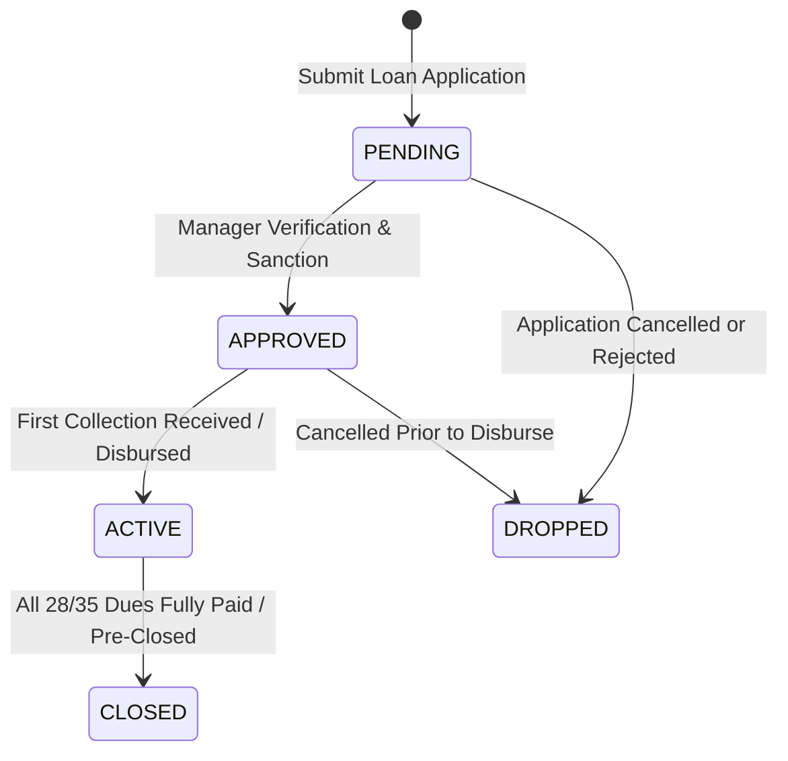

# 📘 Ponnilam Fin Corp — Complete Functions & Features Master Guide
> **Comprehensive Functional Specifications & User Operations Manual for Web Admin Portal, Mobile Application, and Backend Engine**

---

## 📑 Table of Contents

1. [System Overview & Core Business Model](#1-system-overview--core-business-model)
2. [Web Admin Portal — Complete Functional Manual (`ponnilam_ui`)](#2-web-admin-portal--complete-functional-manual-ponnilam_ui)
   - 2.1 [Dashboard & Analytics Module](#21-dashboard--analytics-module)
   - 2.2 [Masters Management Module (Branches, Areas, Centers, Packages)](#22-masters-management-module)
   - 2.3 [Customer Management & KYC Module](#23-customer-management--kyc-module)
   - 2.4 [Loan Origination & Lifecycle Management Module](#24-loan-origination--lifecycle-management-module)
   - 2.5 [Collections Management Module](#25-collections-management-module)
     - Bulk Center Collection Sheet
     - Single Collection Entry
     - Overdue / Arrears Recovery
     - Staff Mobile Entry Review & Approval
     - Collection Void & Auto-Replay Engine
   - 2.6 [Financial Accounting & Dual Ledgers](#26-financial-accounting--dual-ledgers)
   - 2.7 [Reports & Business Intelligence Module](#27-reports--business-intelligence-module)
   - 2.8 [Staff Field Activities & Remote Media Upload](#28-staff-field-activities--remote-media-upload)
   - 2.9 [Audit Logs & System Security Module](#29-audit-logs--system-security-module)
   - 2.10 [Settings, User Roles & Menu Permissions Matrix](#210-settings-user-roles--menu-permissions-matrix)
3. [Mobile Application — Complete Functional Manual (`ponnilam_app`)](#3-mobile-application--complete-functional-manual-ponnilam_app)
   - 3.1 [Authentication & Multi-Role Functions](#31-authentication--multi-role-functions)
   - 3.2 [Field Officer / Collection Staff Functions](#32-field-officer--collection-staff-functions)
   - 3.3 [Borrower / Customer Digital Passbook Functions](#33-borrower--customer-digital-passbook-functions)
4. [Backend Calculation & Algorithmic Engine (`ponnilam_server`)](#4-backend-calculation--algorithmic-engine-ponnilam_server)
   - 4.1 `computeFlatEmi` (Flat Rate Installment Math)
   - 4.2 `buildScheduleRows` (Schedule Generator)
   - 4.3 `allocateCollection` (FIFO Allocation & Pre-Close Safety Guard)
   - 4.4 `processLoanCollection` (Official Collection Pipeline)
   - 4.5 `voidCollection` (Atomic Void & Replay Mechanism)
   - 4.6 `Sequence Engine` (Atomic TRN, LN, CUS Identifiers)
   - 4.7 `Security & Branch Scoping Engine` (Data Insulation)
5. [User Roles & Access Control Matrix](#5-user-roles--access-control-matrix)
6. [Production Deployment & Operational Workflows](#6-production-deployment--operational-workflows)

---

## 1. System Overview & Core Business Model

**Ponnilam Fin Corp** is an enterprise-grade **Microfinance Institution (MFI / NBFC) & Self-Help Group (SHG) Lending Management Ecosystem**.

### Core Business Model:
- **Group Lending / SHG Centers**: Borrowers (typically women in Self-Help Groups) are organized into localized **Centers** of 5 to 20 members.
- **Center Meeting Day**: Each center conducts meetings on a dedicated day of the week (e.g. Monday, Wednesday) at a scheduled time.
- **Flat-Rate Repayment Plans**: Loans are issued under standardized packages (e.g. ₹15,000 / ₹20,000 principal with 10%–15% flat interest, repayable over 28 or 35 weekly installments).
- **Dual Operations**:
  - **Web Admin Portal (`ponnilam_ui`)**: Used by Head Office, Branch Managers, Accountants, and Cashiers for loan approvals, bulk collections, ledger accounting, and compliance.
  - **Mobile App (`ponnilam_app`)**: Used by **Field Officers** on smartphones to record collections at center meetings and by **Borrowers** to view their personal digital loan passbook.

```
c:\Users\HP\Documents\ponnilam\
├── ponnilam_server/   ➜ Node.js + Express + TypeScript + Prisma Backend Engine
├── ponnilam_ui/       ➜ Next.js 14 + Tailwind CSS Web Admin Portal
└── ponnilam_app/      ➜ React Native / Expo SDK 57 Mobile App (Staff & Customer)
```

---

## 2. Web Admin Portal — Complete Functional Manual (`ponnilam_ui`)

### 2.1 Dashboard & Analytics Module (`/admin/dashboard`)

| Function | Screen Action & Business Value |
|:---|:---|
| **Executive Metric Cards** | Displays live real-time totals: **Active Loans Count**, **Total Outstanding Portfolio (₹)**, **Today's Expected Collection Demand (₹)**, and **Collected Today (₹)**. |
| **Branch Context Switcher** | Allows Head Office Executives to view aggregate data across all branches (`All Branches`) or isolate metrics for any specific branch office. |
| **Branch Target vs Achievement Chart** | Visual comparison tracking monthly branch recovery quotas against actual collected amounts. |
| **Recovery Efficiency Gauge** | Real-time percentage indicator showing collection rate (e.g. 98.5% recovery rate for the selected day). |
| **Quick Action Shortcuts** | 1-click links to Bulk Collection, New Loan Application, Customer Registration, and Day Book. |

---

### 2.2 Masters Management Module (`/admin/masters`)

#### 1. Branch Management (`/admin/masters/branches`)
- **Add Branch**: Register physical branch offices with Branch Name, Unique Branch Code (e.g., `BR001`), Location, District, State, and Official Telephone.
- **Activate / Deactivate Branch**: Temporarily disable branch operations without deleting historical records.
- **Branch Scope**: Every user, customer, center, and loan is pinned to a specific branch for absolute data insulation.

#### 2. Area Management (`/admin/masters/areas`)
- **Add Area**: Divide branches into geographical territories (villages, wards, neighborhood clusters).
- **Assign to Branch**: Map areas to their parent branch.
- **Field Officer Assignment**: Restrict staff collection permissions exclusively to their assigned areas.

#### 3. Center (SHG) Management (`/admin/masters/centers`)
- **Create Center**: Register a new Self-Help Group Center with Center Name, Area, and Repayment Mode (`WEEKLY`, `DAILY`, `MONTHLY`).
- **Auto Short Code Generation**: Automatically creates a 3-letter alphanumeric center code (e.g., `SHINI JEEVA NAGAR` $\to$ `SAT0027` or `SJN001`).
- **Meeting Day Configuration (`emiDayOfWeek`)**: Configures the recurring weekly meeting day (e.g., Monday = 1, Tuesday = 2, Sunday = 0).
- **Meeting Time**: Specific field collection time (e.g., 09:30 AM).
- **Agent Staff Assignment**: Assigns the responsible Field Officer / Collection Staff by Staff ID.
- **Center Member Capacity**: Defines maximum group size (e.g., 10 or 20 members).
- **Joint Liability Agreement Print**: Generates and prints official Joint Liability Guarantee contracts for all center members.

#### 4. Loan Packages Management (`/admin/masters/loan-packages`)
- **Add Package**: Configure loan products (e.g., `Weekly 20K - 35 Dues`).
- **Interest Rate (%)**: Flat percentage rate charged across the entire tenure.
- **Tenure & Number of Dues**: Total installment count (e.g., 28 dues, 35 dues).
- **Repayment Frequency**: Repayment interval (`WEEKLY`, `DAILY`, `MONTHLY`).
- **Processing Deduction (%)**: Upfront administrative or documentation fees deducted from net disbursement.

---

### 2.3 Customer Management & KYC Module (`/admin/customers`)

| Function | Screen Action & Business Rule |
|:---|:---|
| **Customer Registration (`/admin/customers/create`)** | Capture member details: Full Name, Spouse / Guardian Name, Gender, Date of Birth, Phone Number, and Residential Address. |
| **Aadhaar & PAN Deduplication** | Real-time validation: Entering a 12-digit Aadhaar number instantly checks the database to prevent duplicate registrations or multi-borrowing across different centers. |
| **Center & Group Mapping** | Assign the customer to a specific Center and Group number (e.g., Center: `SAT0027`, Group: 1). |
| **KYC Document Upload** | Upload member passport photograph, Aadhaar card scan, and signature image. |
| **Member Profile & Loan History** | View borrower profile showing all past closed loans, current active loans, total lifetime repaid, and family income/expense profile. |
| **Member Deactivation** | Deactivate members who have exited the group; deactivated members cannot receive new loan sanctions. |

---

### 2.4 Loan Origination & Lifecycle Management Module (`/admin/loans`)



#### Loan Status Workflow:
1. **PENDING**: Application submitted, undergoing document verification.
2. **APPROVED**: Manager approved terms; installment schedules atomically generated.
3. **ACTIVE**: Loan disbursed and actively being repaid at weekly meetings.
4. **CLOSED**: All installment schedules paid in full; balance is ₹0.
5. **DROPPED**: Loan application or approved loan cancelled prior to disbursement; liability reversed.

#### Key Functions & Screens:
- **Loan Application (`/admin/loans/create`)**:
  - Select customer from directory.
  - Choose Loan Package (auto-populates interest rate and tenure).
  - Enter Principal Amount.
  - Select First Due Date (`firstDueDate`).
  - System automatically calculates Total Due, Per Due EMI Amount, and Eligible EMI based on household cash flows.
- **Loan Sanction & Approval (`/admin/loans/approval`)**:
  - Branch Manager inspects KYC and income eligibility.
  - Clicking **Approve** triggers the automated schedule generator, creating 28 or 35 `LoanSchedule` rows in `PENDING` status.
  - Generates initial `Disbursement` entry in `CustomerLedger` and `LoanLedger`.
- **Loan Details & Passbook (`/admin/loans/[id]`)**:
  - Comprehensive contract card showing Principal, Total Interest, Paid Amount, Remaining Outstanding, and Paid Dues count.
  - Full repayment schedule matrix: Installment #, Due Date, EMI Amount, Paid Date, Status (`PAID` in green, `PARTIAL` in yellow, `PENDING` in gray), and Receipt Link (`TRN...`).
- **Print Loan Documents**:
  - **Promissory Note (புரோநோட்)**: Prints formal legal borrower promissory note in Tamil / English.
  - **Repayment Schedule Card**: Prints physical customer collection passbook card.
- **Drop Loan Function**:
  - Reverses approval if customer changes mind before receiving cash; atomically deletes uncollected schedules and zeroes financial balances.

---

### 2.5 Collections Management Module (`/admin/collections`)

#### 1. Bulk Center Collection Sheet (`/admin/collections/bulk`)
The core daily high-speed collection engine used by cashiers and field officers:
- **Center & Date Auto-Filter**: Selecting a transaction date automatically filters and displays only centers scheduled for meetings on that day.
- **Live Member Collection Grid**:
  - Columns: S.No, Customer Name, Loan Number, Weekly EMI, Arrears, Outstanding, Total Dues, Paid Dues, Collection Amount Input, Remarks.
- **Smart Due Pre-Filling**:
  - Automatically calculates and populates input boxes with:
    $$\text{Suggested Amount} = \text{Today's Due} + \text{Arrears}$$
- **Inline Amount Editing**: Supports partial payments or zero payments if a member is absent.
- **Live Summary Widget**:
  - Total Members, Active Loans, Expected Collection (₹), Total Collected (₹), Remaining (₹), Collection %.
- **1-Click Atomic Save**:
  - Clicking **Save Collection** executes a single database transaction:
    - Creates unique `Collection` records with sequential `TRN` numbers.
    - Allocates funds to overdue/current schedules via FIFO.
    - Decrements loan `outstandingAmount`.
    - Writes immutable entries into `CustomerLedger` and `LoanLedger`.
- **Export Sheet**: Download the collection sheet as Excel or printable PDF.

#### 2. Single Collection Entry (`/admin/collections/create`)
- For ad-hoc walk-in payments at the branch counter.
- Search by Loan Number $\to$ System displays outstanding demand $\to$ Enter payment $\to$ Generates immediate printable counter receipt.

#### 3. Overdue & Arrears Recovery (`/admin/collections/overdue`)
- Dedicated dashboard tracking defaulters and overdue accounts.
- Shows total missed installments, accumulated penalty/arrears, and direct borrower contact numbers.
- Allows direct collection posting against arrears balances.

#### 4. Staff Mobile Entry Review & Confirmation (`/admin/collections/staff-entries`)
- Collects mobile batches submitted by field officers from smartphones.
- Branch manager verifies physical cash received from the field officer $\to$ Clicks **Confirm Batch**.
- All batch entries atomically convert into official `Collection` receipts and update ledgers.

#### 5. Collection Void & Auto-Replay Engine
- Used if a payment was entered under the wrong loan or incorrect amount.
- Locate receipt by `TRN` number $\to$ Click **Void** $\to$ Enter mandatory audit reason $\to$ Confirm.
- **Chronological Replay**: The engine marks the collection voided, resets all affected loan schedules to `PENDING`, and re-runs all remaining valid collections in chronological order. This restores 100% accurate balances without manual spreadsheet adjustments.

---

### 2.6 Financial Accounting & Dual Ledgers

The system maintains two independent, synchronized financial ledgers:

#### 1. Customer Ledger (`/admin/customer-ledger`)
Tracks personal borrower liability:
- **Disbursement (+)**: Loan sanction increases borrower's balance.
- **Collection (-)**: Installment payment reduces borrower's balance.
- **Void (+)**: Cancelled collection restores borrower's liability.
- **Pre-Close (-)**: Full settlement reduces borrower's liability to zero.

#### 2. Loan Ledger
Tracks contract-specific amortization:
- Records Date, Voucher/Receipt Number, Transaction Type (`Disbursement`, `EMI Collection`, `Pre-Close`, `Loan Dropped`), Debit, Credit, and exact closing balance.

---

### 2.7 Reports & Business Intelligence Module (`/admin/reports`)

| Report | Purpose & Output |
|:---|:---|
| **Day Book** | Chronological record of all cash debits (disbursements) and cash credits (collections) for any selected date. Matches counter cash in hand. |
| **DCB Statement (Demand, Collection, Balance)** | Institutional microfinance compliance statement tracking Opening Demand, Collected Amount, Arrears, and Closing Portfolio. |
| **Collection Register** | Searchable audit list of all receipts issued across date ranges, filterable by Branch, Center, Staff, or Mode. |
| **Center Summary Report** | Center-by-center comparison showing total members, active loans, sanctioned amounts, recovery rates, and default percentages. |
| **Staff Performance Report** | Field officer ranking report tracking collection efficiency, on-time recovery rate, and total cash handled. |

---

### 2.8 Staff Field Activities & Remote Media Upload (`/admin/activities`)

- **Field Activity Logging**: Field officers log center meetings, borrower house visits, group formation meetings, and recovery drives.
- **Remote FTP Media Sync**: Field photos captured on mobile devices are automatically uploaded via secure FTP to `ftp.jeenora.cloud` and displayed directly inside the admin portal.

---

### 2.9 Audit Logs & System Security Module (`/admin/audit-logs`)

- **Tamper-Proof Audit Trail**: Logs every create, update, delete, approval, and void action.
- **Captures**: Action type, Target Entity (Loan, Customer, Collection), Record ID, Old Values (JSON), New Values (JSON), User ID, Timestamp, and Client IP Address.

---

### 2.10 Settings, User Roles & Menu Permissions Matrix (`/admin/settings`)

- **User Accounts**: Manage credentials, phone numbers, assigned branch, and assigned staff profile.
- **Granular Menu Permissions**: Control access for each route (`/admin/loans`, `/admin/collections`, etc.) with 4 discrete flags:
  - `canView`: View list and details.
  - `canCreate`: Submit new records.
  - `canUpdate`: Edit existing records.
  - `canDelete`: Delete or void records.

---

## 3. Mobile Application — Complete Functional Manual (`ponnilam_app`)

Built with **React Native and Expo SDK 57**, optimized for Android field smartphones.

### 3.1 Authentication & Multi-Role Functions

1. **Dual Role Switcher**: Interactive toggle on the login screen between **Collection Staff** and **Customer**.
2. **Staff Login**: Phone number + Password or Phone number + OTP.
3. **Customer Login**: 10-digit registered loan mobile number + 6-digit SMS OTP verification (passwordless).
4. **Bi-Lingual Interface (English & தமிழ்)**: Instant 1-tap language switcher across all mobile screens.
5. **Dynamic Server Switcher**: Modal dialog allowing field staff to toggle between testing environments and production VPS (`api.ponnilamfincorp.com`).

---

### 3.2 Field Officer / Collection Staff Functions

```
📱 Staff Home Screen
├── 📍 Today's Centers (Scheduled Center Meetings)
│   ├── Center Name (e.g. SHINI JEEVA NAGAR)
│   ├── Meeting Time & Area
│   └── Member Count
│
├── 📝 Center Collection Sheet (Interactive Roster)
│   ├── Member Cards (Customer Name, Loan No, Weekly EMI)
│   ├── 🔘 1-Tap "Mark All Full EMI" (Instant 100% Fill)
│   ├── ✏️ Individual Amount Adjustment (Partial / Arrears)
│   ├── 📊 Live Total Counter (Cash in hand counter)
│   └── 🚀 Submit Batch to Server (Instant server sync)
│
├── ⚠️ Overdue Follow-up Tracker (Defaulters List)
│   └── 📞 Direct Call Button (Instant phone call from app)
│
└── 👤 Staff Profile (Branch, Staff No, Logout)
```

#### Key Capabilities:
- **Paperless Field Meetings**: Replaces physical collection books.
- **1-Tap Full Collection**: Instantly marks all group members as paid with their exact weekly EMI.
- **Direct Borrower Calling**: Phone icon next to members with arrears initiates phone calls directly through the phone dialer.
- **Instant Server Sync**: Uploads batches directly to the central database, generating live transaction numbers.

---

### 3.3 Borrower / Customer Digital Passbook Functions

1. **Digital Loan Passbook Card**:
   - Loan Contract Number (e.g. `SAT-L0451`).
   - Principal Loan Amount (e.g. ₹20,000).
   - Weekly EMI Installment (e.g. ₹750).
   - Remaining Balance Countdown (e.g. ₹18,000).
   - Visual Repayment Progress Bar (e.g. 35% paid).
2. **Repayment Schedule Checklist**:
   - Visual checklist of all 28 or 35 weeks.
   - Paid installments display a green checkmark with the exact payment date.
   - Upcoming installments display `PENDING`.
3. **Official Digital Receipts**:
   - View official payment receipts showing receipt number (`TRN...`), date, amount paid, and cashier/staff name.
4. **Officer Support**:
   - Displays the assigned Field Officer's name and telephone number with 1-tap call support.

---

## 4. Backend Calculation & Algorithmic Engine (`ponnilam_server`)

All calculations and business rules are encapsulated in `src/utils/`.

### 4.1 `computeFlatEmi` ([src/utils/loan.utils.ts](file:///c:/Users/HP/Documents/ponnilam/ponnilam_server/src/utils/loan.utils.ts#L10))
Calculates weekly installment amounts while eliminating rounding errors:

```typescript
export function computeFlatEmi(principal: number, ratePercent: number, noOfDues: number) {
  const totalDueAmount = Math.round(principal * (1 + ratePercent / 100));
  const perDueAmount = Math.floor(totalDueAmount / noOfDues);
  const lastEmiAmount = totalDueAmount - perDueAmount * (noOfDues - 1);
  return { perDueAmount, lastEmiAmount, totalDueAmount };
}
```
- **Precision Guarantee**: Any fraction from integer division is automatically merged into `lastEmiAmount`. The sum of all installments strictly equals `totalDueAmount`.

---

### 4.2 `buildScheduleRows` ([src/utils/loan.utils.ts](file:///c:/Users/HP/Documents/ponnilam/ponnilam_server/src/utils/loan.utils.ts#L34))
Generates installment schedules during loan approval:
- Sets incremental dates (adds 7 days for weekly loans).
- Sets `emiAmount` (with remainder on final installment).
- Sets initial status to `PENDING`.

---

### 4.3 `allocateCollection` ([src/utils/collection.utils.ts](file:///c:/Users/HP/Documents/ponnilam/ponnilam_server/src/utils/collection.utils.ts#L21))
The core fund distribution algorithm:

```typescript
export async function allocateCollection(
  tx: Tx,
  loanId: string,
  schedules: ScheduleRow[],
  poolAmount: number,
  trnDate: Date,
  collectionId: string,
  options?: { isPreClose?: boolean; actualAmount?: number }
)
```

#### Core Business Rules:
1. **FIFO Amortization**: Overdue installments with `dueDate <= targetDay` are satisfied first.
2. **Meeting-Day Pre-Allocation**: If today is the center meeting day and no previous installments are overdue, the engine allocates up to **one upcoming installment**, preventing funds from getting trapped as phantom advance balances.
3. **Pre-Close Safety Guard**:
   - Accumulated `advanceBalance` will **never** trigger an automatic Pre-Close.
   - Pre-Close is strictly permitted only if:
     a) Explicitly marked as Pre-Close/Account Closure, OR
     b) The actual cash/bank payment in that single transaction covers the entire outstanding debt (`actualAmount >= totalUnpaid - 0.01`).
   - Normal installment payments (e.g. ₹650 or ₹750) will **never close future unbilled schedules**.

---

### 4.4 `processLoanCollection` ([src/utils/collection.utils.ts](file:///c:/Users/HP/Documents/ponnilam/ponnilam_server/src/utils/collection.utils.ts#L116))
Executes complete collection lifecycle inside an atomic database transaction:
- Validates loan collectible status (`ACTIVE` or `APPROVED`).
- Validates branch access and staff identity.
- Prevents duplicate same-day entries.
- Invokes `allocateCollection`.
- Recalculates `outstandingAmount` via `sumUnpaidScheduleAmount`.
- Updates `Loan` record and generates `CustomerLedger` and `LoanLedger` entries.

---

### 4.5 `voidCollection` ([src/utils/collection.utils.ts](file:///c:/Users/HP/Documents/ponnilam/ponnilam_server/src/utils/collection.utils.ts#L340))
Reverses accidental collections:
- Flags collection as `isVoided = true`.
- Resets all loan schedules to `PENDING`.
- Re-runs all remaining valid collections chronologically to recalculate schedule statuses and outstanding balance.

---

### 4.6 `Sequence Engine` ([src/utils/sequence.utils.ts](file:///c:/Users/HP/Documents/ponnilam/ponnilam_server/src/utils/sequence.utils.ts))
Uses atomic database increments to generate zero-collision identifiers:
- **Collections**: `TRN000001`, `TRN000002`...
- **Loans**: `SAT-L0001`, `SAT-L0002`...
- **Customers**: `CUS0001`, `CUS0002`...

---

### 4.7 `Security & Branch Scoping Engine` ([src/utils/security.utils.ts](file:///c:/Users/HP/Documents/ponnilam/ponnilam_server/src/utils/security.utils.ts))
- Enforces branch data isolation at the ORM layer.
- Prevents staff in Branch A from querying or posting collections against loans in Branch B.

---

## 5. User Roles & Access Control Matrix

| System Module / Function | Super Admin | Branch Manager | Cashier / Officer | Field Officer (Mobile) | Customer (Borrower) |
|:---|:---:|:---:|:---:|:---:|:---:|
| **Executive Dashboard & KPIs** | ✅ Global | ⚠️ Own Branch | ⚠️ Own Branch | ❌ No | ❌ No |
| **Branch & Area Masters** | ✅ Yes | ❌ No | ❌ No | ❌ No | ❌ No |
| **Center Creation & Staff Assignment** | ✅ Yes | ✅ Yes | 👁️ View Only | ❌ No | ❌ No |
| **Customer Registration & KYC** | ✅ Yes | ✅ Yes | ✅ Yes | 👁️ View Only | ❌ No |
| **Loan Application Creation** | ✅ Yes | ✅ Yes | ✅ Yes | ❌ No | ❌ No |
| **Loan Sanction & Approval** | ✅ Yes | ✅ Yes | ❌ No | ❌ No | ❌ No |
| **Bulk Center Collection Entry** | ✅ Yes | ✅ Yes | ✅ Yes | ❌ No | ❌ No |
| **Mobile Field Collection Submit** | ❌ No | ❌ No | ❌ No | ✅ Yes | ❌ No |
| **Confirm Mobile Staff Entries** | ✅ Yes | ✅ Yes | ❌ No | ❌ No | ❌ No |
| **Void Collection Receipt** | ✅ Yes | ✅ Yes | ❌ No | ❌ No | ❌ No |
| **Day Book & Financial Reports** | ✅ Yes | ✅ Yes | 👁️ View Only | ❌ No | ❌ No |
| **Audit Logs & System Settings** | ✅ Yes | ❌ No | ❌ No | ❌ No | ❌ No |
| **Personal Digital Passbook & Receipts**| ❌ No | ❌ No | ❌ No | ❌ No | ✅ Personal Loan Only |

---

## 6. Production Deployment & Operational Workflows

### Standard Server Deployment (`api.ponnilamfincorp.com`):
```bash
# 1. Connect to production server
ssh root@api.ponnilamfincorp.com

# 2. Enter server directory
cd /www/wwwroot/ponnilam_server

# 3. Pull latest code
git pull origin main

# 4. Compile TypeScript
npm run build

# 5. Zero-downtime PM2 reload
pm2 restart ponnilam_server
```

---
*Manual Version: 3.2.0 | Ponnilam Fin Corp Engineering Team*
